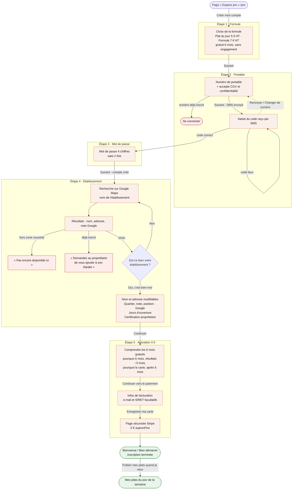

# Tunnel de création d'un compte pro — Plats du Jour

**Mis à jour :** 2026-10-13 (inscription sans SIRET, établissement choisi sur Google Maps, 2 formules)

**À savoir**
- Chaque étape est mesurée (Umami : `inscription-formule` … `inscription-termine`) pour suivre les abandons
- Un restaurateur qui s'arrête en cours de route (après l'étape 3) reprend là où il en était en se reconnectant (menu « Inscription en cours » → « Reprendre mon inscription »)
- Aucun plat n'est demandé pendant l'inscription : il publie quand il veut, depuis « Mes plats du jour »
- En démo : pas de vrai SMS (le code s'affiche), pas de vrai Stripe, établissements Google fictifs (« test »)
